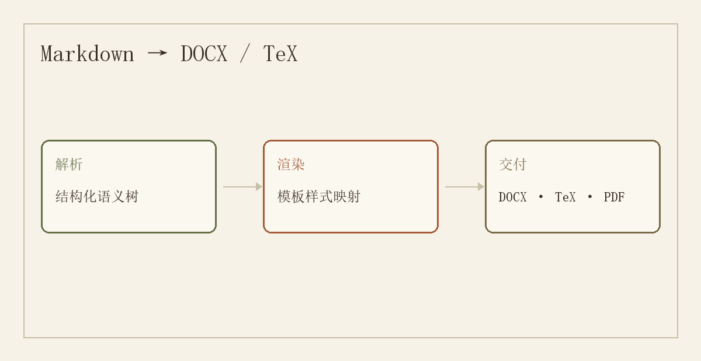

# 引言

当前，学术写作依赖字处理软件的手工排版，标题层级、图表题注与参考文献往往需要逐项调整，格式一致性难以保证。**结构化写作**将内容与版式分离，使作者能够专注于论证本身，而把重复性的排版工作交给程序。

本文提出一条以 *Markdown* 为唯一信源的出版管线：作者只维护一份带有 YAML frontmatter 的纯文本，渲染器据此生成 Word 文稿与 LaTeX 源文件。二者的正文结构、字号、行距与页边距均由模板控制，而非在转换过程中临时设定。

{width=12cm align=center}

# 管线设计

## 共享解析层

解析器读取 frontmatter，并把正文转换为 `Block` 与 `Inline` 组成的语义树。标题、段落、列表、表格、代码与公式都成为可检查的节点，任何降级行为都会附带行号进入告警清单。

- 统一信源：一份 Markdown，两端输出
- 语义映射：结构节点不携带版式信息
- 可追溯：校验器在转换前给出全部问题
  - 缺失标题与必填字段
  - 图片路径与列表深度
  - 模板样式与锚点

## 双端渲染层

DOCX 渲染器在模板中定位内容锚点，逐块插入段落、表格与图片，所有字号和行距来自模板样式；TeX 渲染器只生成正文片段，版面由导言区与 `titlesec` 控制。两种输出共享同一棵语义树，因此不会出现内容漂移。

> 模板定排版，Markdown 定内容，程序定映射。

| 层级 | 输入 | DOCX | TeX |
| --- | --- | --- | --- |
| 解析 | Markdown | 语义树 | 语义树 |
| 渲染 | 语义树 | 模板样式 | 导言区命令 |
| 交付 | 渲染结果 | .docx | .tex / .pdf |

## 交付

转换结果既可以在浏览器中直接下载，也可以经由本机 MiKTeX 编译为 PDF。编译日志、宏包安装提示与错误行号会原样回传到控制台，便于定位问题。

```python
def render(document, template):
    body = "".join(render_block(b) for b in document.blocks)
    return template.render(body=body, **document.metadata)
```

# 版式复现

参考版式采用 A4 纸，上下页边距 2.54 厘米、左右 3.18 厘米；正文五号，行距约为 1.25 倍；一级标题三号加粗，二级标题五号加粗，均不编号。摘要与关键词紧随标题，参考文献置于文末。DOCX 版本另设目录页，正文自第一页重新编号。

行内公式如 $E = mc^2$ 由 TeX 原生排版。块级公式同样直接进入数学环境：

$$
\mathrm{Similarity}(A,B) = \frac{|A \cap B|}{|A \cup B|}
$$

<!-- pagebreak -->

# 讨论

管线仍有三个边界需要持续处理：图片路径在不同工作目录下的解析、缺失字体时的回退策略，以及目录页码在长文档中的更新时机。模板作者应在发布前使用真实文稿进行至少一次端到端编译，并将所有样式集中在模板中维护。

# 参考文献

王强. 结构化写作与自动排版[J]. 数字出版, 2026, 12(3): 45-58.

李明. 文档模板的语义映射方法研究[D]. 北京: 清华大学, 2025.
